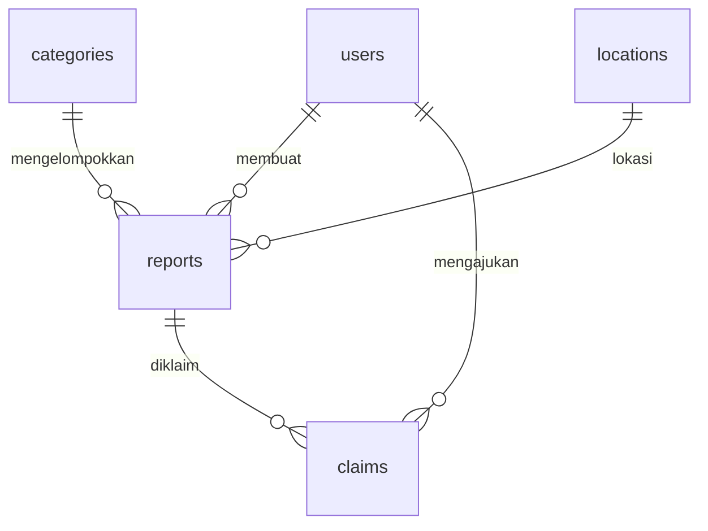

# FoundIt! API (Campus Item Recovery System)

REST API untuk platform **FoundIt!**, tempat mahasiswa melaporkan barang hilang atau barang yang ditemukan di lingkungan kampus, lalu mengajukan klaim sampai barang dikembalikan. Dibuat untuk Tugas Akhir Learning Labs: Backend Development.

**Stack:** Node.js, Express, PostgreSQL (Neon/Supabase), deploy di Vercel.

**URL Deployment:** https://foundit-api-three.vercel.app

## Skema Database / ERD

Lima tabel berelasi lewat foreign key. File sumber ERD ada di `docs/erd.dbml` (tempel ke https://dbdiagram.io lalu export gambar, simpan sebagai `docs/erd.png`). Skema SQL ada di `sql/schema.sql`.



| Tabel | Keterangan |
|-------|------------|
| `users` | Data mahasiswa pengguna |
| `categories` | Kategori barang (Elektronik, Dokumen, dst.) |
| `locations` | Lokasi di kampus |
| `reports` | Laporan barang hilang/ditemukan (FK ke users, categories, locations) |
| `claims` | Klaim atas barang ditemukan. Tabel pivot many-to-many users dan reports |

Nilai `reports.type`: `hilang`, `ditemukan`. Nilai `reports.status`: `masih_dicari`, `sudah_ditemukan`, `sudah_dikembalikan`.

## Pemetaan Function List ke Endpoint

| Function | Endpoint |
|----------|----------|
| tambahLaporanHilang() | `POST /reports/lost` |
| tambahLaporanDitemukan() | `POST /reports/found` |
| getDataLaporan() | `GET /reports` |
| getLaporanById() | `GET /reports/:id` |
| updateStatusLaporan() | `PATCH /reports/:id/status` |
| cariLaporanByKategori() | `GET /reports?category_id=` |
| getLaporanByUser() | `GET /users/:id/reports` |
| hapusLaporan() | `DELETE /reports/:id` |

Resource utama dengan CRUD lengkap: **reports** (POST, GET, PUT, PATCH, DELETE).

## Daftar Endpoint

| Method | Path | Nama |
|--------|------|------|
| GET | `/` | Cek Status API |
| GET | `/categories` | Daftar Kategori |
| POST | `/categories` | Tambah Kategori |
| GET | `/locations` | Daftar Lokasi |
| POST | `/locations` | Tambah Lokasi |
| POST | `/users` | Tambah User |
| GET | `/users` | Daftar User |
| GET | `/users/:id` | Detail User |
| POST | `/reports/lost` | Tambah Laporan Hilang |
| POST | `/reports/found` | Tambah Laporan Ditemukan |
| GET | `/reports` | Daftar Laporan |
| GET | `/reports` | Cari Laporan by Kategori |
| GET | `/reports/:id` | Detail Laporan |
| GET | `/users/:id/reports` | Laporan Milik User |
| PUT | `/reports/:id` | Update Laporan |
| PATCH | `/reports/:id/status` | Update Status Laporan |
| POST | `/reports/:id/claims` | Ajukan Klaim |
| GET | `/reports/:id/claims` | Daftar Klaim Laporan |
| PATCH | `/claims/:id` | Proses Klaim |
| DELETE | `/reports/:id` | Hapus Laporan |

Semua request dan response memakai JSON. Status code: `200` OK, `201` Created, `400` input salah, `404` data tidak ditemukan, `409` konflik/duplikat, `500` error server. Semua error berbentuk `{"error": "pesan"}`.

## Dokumentasi Tiap Endpoint

Contoh di bawah mengasumsikan database baru dari `sql/schema.sql` dan dijalankan berurutan.

### Cek Status API
```
- Method       : GET
- URL          : https://foundit-api-three.vercel.app/
- Deskripsi    : Mengecek apakah API berjalan
- Headers      : -
- Request Body : -
- Response Sukses (200):
  {
    "message": "FoundIt! API berjalan",
    "version": "1.0.0"
  }
- Response Error (404):
  {
    "error": "Endpoint tidak ditemukan"
  }
```

### Daftar Kategori
```
- Method       : GET
- URL          : https://foundit-api-three.vercel.app/categories
- Deskripsi    : Mengambil semua kategori barang
- Headers      : -
- Request Body : -
- Response Sukses (200):
  {
    "data": [
      {
        "id": 1,
        "name": "Elektronik"
      }
    ]
  }
- Response Error (500):
  {
    "error": "Terjadi kesalahan pada server"
  }
```

### Tambah Kategori
```
- Method       : POST
- URL          : https://foundit-api-three.vercel.app/categories
- Deskripsi    : Menambahkan kategori barang baru
- Headers      : Content-Type: application/json
- Request Body :
  {
    "name": "Alat Tulis"
  }
- Response Sukses (201):
  {
    "message": "Kategori berhasil ditambahkan",
    "data": {
      "id": 7,
      "name": "Alat Tulis"
    }
  }
- Response Error (400):
  {
    "error": "Field name wajib diisi"
  }
```

### Daftar Lokasi
```
- Method       : GET
- URL          : https://foundit-api-three.vercel.app/locations
- Deskripsi    : Mengambil semua lokasi kampus
- Headers      : -
- Request Body : -
- Response Sukses (200):
  {
    "data": [
      {
        "id": 1,
        "name": "Perpustakaan Pusat"
      }
    ]
  }
- Response Error (500):
  {
    "error": "Terjadi kesalahan pada server"
  }
```

### Tambah Lokasi
```
- Method       : POST
- URL          : https://foundit-api-three.vercel.app/locations
- Deskripsi    : Menambahkan lokasi kampus baru
- Headers      : Content-Type: application/json
- Request Body :
  {
    "name": "Laboratorium Komputer"
  }
- Response Sukses (201):
  {
    "message": "Lokasi berhasil ditambahkan",
    "data": {
      "id": 7,
      "name": "Laboratorium Komputer"
    }
  }
- Response Error (400):
  {
    "error": "Field name wajib diisi"
  }
```

### Tambah User
```
- Method       : POST
- URL          : https://foundit-api-three.vercel.app/users
- Deskripsi    : Mendaftarkan user (mahasiswa) baru
- Headers      : Content-Type: application/json
- Request Body :
  {
    "name": "Dewi Lestari",
    "email": "dewi.lestari@student.uns.ac.id",
    "phone": "081200000000"
  }
- Response Sukses (201):
  {
    "message": "User berhasil ditambahkan",
    "data": {
      "id": 3,
      "name": "Dewi Lestari",
      "email": "dewi.lestari@student.uns.ac.id",
      "phone": "081200000000",
      "created_at": "2026-10-25T09:30:00.000Z"
    }
  }
- Response Error (400):
  {
    "error": "Format email tidak valid"
  }
```

### Daftar User
```
- Method       : GET
- URL          : https://foundit-api-three.vercel.app/users
- Deskripsi    : Mengambil semua user
- Headers      : -
- Request Body : -
- Response Sukses (200):
  {
    "data": [
      {
        "id": 3,
        "name": "Dewi Lestari",
        "email": "dewi.lestari@student.uns.ac.id",
        "phone": "081200000000",
        "created_at": "2026-10-25T09:30:00.000Z"
      }
    ]
  }
- Response Error (500):
  {
    "error": "Terjadi kesalahan pada server"
  }
```

### Detail User
```
- Method       : GET
- URL          : https://foundit-api-three.vercel.app/users/1
- Deskripsi    : Mengambil satu user berdasarkan ID
- Headers      : -
- Request Body : -
- Response Sukses (200):
  {
    "data": {
      "id": 1,
      "name": "Budi Santoso",
      "email": "dewi.lestari@student.uns.ac.id",
      "phone": "081200000000",
      "created_at": "2026-10-25T09:30:00.000Z"
    }
  }
- Response Error (404):
  {
    "error": "User tidak ditemukan"
  }
```

### Tambah Laporan Hilang
```
- Method       : POST
- URL          : https://foundit-api-three.vercel.app/reports/lost
- Deskripsi    : tambahLaporanHilang() - menyimpan laporan barang hilang (status awal: masih_dicari)
- Headers      : Content-Type: application/json
- Request Body :
  {
    "user_id": 1,
    "category_id": 1,
    "location_id": 2,
    "item_name": "Charger Laptop ASUS",
    "description": "Charger hitam, kabel agak kusut",
    "event_time": "2026-10-25T09:30:00+07:00"
  }
- Response Sukses (201):
  {
    "message": "Laporan barang hilang berhasil ditambahkan",
    "data": {
      "id": 1,
      "user_id": 1,
      "category_id": 1,
      "location_id": 2,
      "type": "hilang",
      "item_name": "Charger Laptop ASUS",
      "description": "Charger hitam, kabel agak kusut",
      "event_time": "2026-10-25T09:30:00.000Z",
      "status": "masih_dicari",
      "created_at": "2026-10-25T09:30:00.000Z",
      "updated_at": "2026-10-25T09:30:00.000Z"
    }
  }
- Response Error (400):
  {
    "error": "Field item_name wajib diisi"
  }
```

### Tambah Laporan Ditemukan
```
- Method       : POST
- URL          : https://foundit-api-three.vercel.app/reports/found
- Deskripsi    : tambahLaporanDitemukan() - menyimpan laporan barang yang ditemukan (status awal: sudah_ditemukan)
- Headers      : Content-Type: application/json
- Request Body :
  {
    "user_id": 2,
    "category_id": 1,
    "location_id": 2,
    "item_name": "Charger Laptop ASUS",
    "description": "Ditemukan di meja lantai 2",
    "event_time": "2026-10-25T14:00:00+07:00"
  }
- Response Sukses (201):
  {
    "message": "Laporan barang ditemukan berhasil ditambahkan",
    "data": {
      "id": 2,
      "user_id": 2,
      "category_id": 1,
      "location_id": 2,
      "type": "ditemukan",
      "item_name": "Charger Laptop ASUS",
      "description": "Charger hitam, kabel agak kusut",
      "event_time": "2026-10-25T09:30:00.000Z",
      "status": "sudah_ditemukan",
      "created_at": "2026-10-25T09:30:00.000Z",
      "updated_at": "2026-10-25T09:30:00.000Z"
    }
  }
- Response Error (400):
  {
    "error": "Data referensi (user/kategori/lokasi/laporan) tidak ditemukan"
  }
```

### Daftar Laporan
```
- Method       : GET
- URL          : https://foundit-api-three.vercel.app/reports?type=hilang&limit=10&offset=0
- Deskripsi    : getDataLaporan() - mengambil semua laporan. Filter opsional: type, status, category_id, location_id, user_id, q (cari kata), limit, offset
- Headers      : -
- Request Body : -
- Response Sukses (200):
  {
    "data": [
      {
        "id": 1,
        "user_id": 1,
        "category_id": 1,
        "location_id": 2,
        "type": "hilang",
        "item_name": "Charger Laptop ASUS",
        "description": "Charger hitam, kabel agak kusut",
        "event_time": "2026-10-25T09:30:00.000Z",
        "status": "masih_dicari",
        "created_at": "2026-10-25T09:30:00.000Z",
        "updated_at": "2026-10-25T09:30:00.000Z",
        "user_name": "Budi Santoso",
        "category_name": "Elektronik",
        "location_name": "Gedung FTIS"
      }
    ],
    "meta": {
      "total": 1,
      "limit": 10,
      "offset": 0
    }
  }
- Response Error (400):
  {
    "error": "Nilai type harus salah satu dari: hilang, ditemukan"
  }
```

### Cari Laporan by Kategori
```
- Method       : GET
- URL          : https://foundit-api-three.vercel.app/reports?category_id=1
- Deskripsi    : cariLaporanByKategori() - memfilter laporan berdasarkan kategori
- Headers      : -
- Request Body : -
- Response Sukses (200):
  {
    "data": [
      {
        "id": 2,
        "user_id": 2,
        "category_id": 1,
        "location_id": 2,
        "type": "ditemukan",
        "item_name": "Charger Laptop ASUS",
        "description": "Charger hitam, kabel agak kusut",
        "event_time": "2026-10-25T09:30:00.000Z",
        "status": "sudah_ditemukan",
        "created_at": "2026-10-25T09:30:00.000Z",
        "updated_at": "2026-10-25T09:30:00.000Z",
        "user_name": "Siti Rahma",
        "category_name": "Elektronik",
        "location_name": "Gedung FTIS"
      },
      {
        "id": 1,
        "user_id": 1,
        "category_id": 1,
        "location_id": 2,
        "type": "hilang",
        "item_name": "Charger Laptop ASUS",
        "description": "Charger hitam, kabel agak kusut",
        "event_time": "2026-10-25T09:30:00.000Z",
        "status": "masih_dicari",
        "created_at": "2026-10-25T09:30:00.000Z",
        "updated_at": "2026-10-25T09:30:00.000Z",
        "user_name": "Budi Santoso",
        "category_name": "Elektronik",
        "location_name": "Gedung FTIS"
      }
    ],
    "meta": {
      "total": 2,
      "limit": 20,
      "offset": 0
    }
  }
- Response Error (400):
  {
    "error": "ID harus berupa bilangan bulat positif"
  }
```

### Detail Laporan
```
- Method       : GET
- URL          : https://foundit-api-three.vercel.app/reports/1
- Deskripsi    : getLaporanById() - mengambil detail satu laporan
- Headers      : -
- Request Body : -
- Response Sukses (200):
  {
    "data": {
      "id": 1,
      "user_id": 1,
      "category_id": 1,
      "location_id": 2,
      "type": "hilang",
      "item_name": "Charger Laptop ASUS",
      "description": "Charger hitam, kabel agak kusut",
      "event_time": "2026-10-25T09:30:00.000Z",
      "status": "masih_dicari",
      "created_at": "2026-10-25T09:30:00.000Z",
      "updated_at": "2026-10-25T09:30:00.000Z",
      "user_name": "Budi Santoso",
      "category_name": "Elektronik",
      "location_name": "Gedung FTIS"
    }
  }
- Response Error (404):
  {
    "error": "Laporan tidak ditemukan"
  }
```

### Laporan Milik User
```
- Method       : GET
- URL          : https://foundit-api-three.vercel.app/users/1/reports
- Deskripsi    : getLaporanByUser() - semua laporan yang dibuat satu user (halaman Laporan Saya)
- Headers      : -
- Request Body : -
- Response Sukses (200):
  {
    "data": [
      {
        "id": 1,
        "user_id": 1,
        "category_id": 1,
        "location_id": 2,
        "type": "hilang",
        "item_name": "Charger Laptop ASUS",
        "description": "Charger hitam, kabel agak kusut",
        "event_time": "2026-10-25T09:30:00.000Z",
        "status": "masih_dicari",
        "created_at": "2026-10-25T09:30:00.000Z",
        "updated_at": "2026-10-25T09:30:00.000Z",
        "user_name": "Budi Santoso",
        "category_name": "Elektronik",
        "location_name": "Gedung FTIS"
      }
    ]
  }
- Response Error (404):
  {
    "error": "User tidak ditemukan"
  }
```

### Update Laporan
```
- Method       : PUT
- URL          : https://foundit-api-three.vercel.app/reports/1
- Deskripsi    : Mengubah seluruh data laporan (user_id dan type tidak bisa diubah)
- Headers      : Content-Type: application/json
- Request Body :
  {
    "category_id": 1,
    "location_id": 2,
    "item_name": "Charger Laptop ASUS 65W",
    "description": "Charger hitam 65W, ada stiker nama",
    "event_time": "2026-10-25T09:30:00+07:00"
  }
- Response Sukses (200):
  {
    "message": "Laporan berhasil diperbarui",
    "data": {
      "id": 1,
      "user_id": 1,
      "category_id": 1,
      "location_id": 2,
      "type": "hilang",
      "item_name": "Charger Laptop ASUS 65W",
      "description": "Charger hitam 65W, ada stiker nama",
      "event_time": "2026-10-25T09:30:00.000Z",
      "status": "masih_dicari",
      "created_at": "2026-10-25T09:30:00.000Z",
      "updated_at": "2026-10-25T09:30:00.000Z"
    }
  }
- Response Error (404):
  {
    "error": "Laporan tidak ditemukan"
  }
```

### Update Status Laporan
```
- Method       : PATCH
- URL          : https://foundit-api-three.vercel.app/reports/1/status
- Deskripsi    : updateStatusLaporan() - mengubah status laporan (masih_dicari, sudah_ditemukan, sudah_dikembalikan)
- Headers      : Content-Type: application/json
- Request Body :
  {
    "status": "sudah_ditemukan"
  }
- Response Sukses (200):
  {
    "message": "Status laporan berhasil diperbarui",
    "data": {
      "id": 1,
      "user_id": 1,
      "category_id": 1,
      "location_id": 2,
      "type": "hilang",
      "item_name": "Charger Laptop ASUS",
      "description": "Charger hitam, kabel agak kusut",
      "event_time": "2026-10-25T09:30:00.000Z",
      "status": "sudah_ditemukan",
      "created_at": "2026-10-25T09:30:00.000Z",
      "updated_at": "2026-10-25T09:30:00.000Z"
    }
  }
- Response Error (400):
  {
    "error": "Status harus salah satu dari: masih_dicari, sudah_ditemukan, sudah_dikembalikan"
  }
```

### Ajukan Klaim
```
- Method       : POST
- URL          : https://foundit-api-three.vercel.app/reports/2/claims
- Deskripsi    : Mengajukan klaim atas laporan barang ditemukan (hanya untuk laporan type ditemukan)
- Headers      : Content-Type: application/json
- Request Body :
  {
    "claimer_id": 1,
    "message": "Itu charger saya, hilang kemarin di Gedung FTIS"
  }
- Response Sukses (201):
  {
    "message": "Klaim berhasil diajukan",
    "data": {
      "id": 1,
      "report_id": 2,
      "claimer_id": 1,
      "message": "Itu charger saya, hilang kemarin di Gedung FTIS",
      "status": "pending",
      "created_at": "2026-10-25T09:30:00.000Z"
    }
  }
- Response Error (409):
  {
    "error": "Klaim untuk laporan ini sudah pernah diajukan oleh user tersebut"
  }
```

### Daftar Klaim Laporan
```
- Method       : GET
- URL          : https://foundit-api-three.vercel.app/reports/2/claims
- Deskripsi    : Mengambil semua klaim pada satu laporan
- Headers      : -
- Request Body : -
- Response Sukses (200):
  {
    "data": [
      {
        "id": 1,
        "report_id": 2,
        "claimer_id": 1,
        "message": "Itu charger saya, hilang kemarin di Gedung FTIS",
        "status": "pending",
        "created_at": "2026-10-25T09:30:00.000Z",
        "claimer_name": "Budi Santoso"
      }
    ]
  }
- Response Error (404):
  {
    "error": "Laporan tidak ditemukan"
  }
```

### Proses Klaim
```
- Method       : PATCH
- URL          : https://foundit-api-three.vercel.app/claims/1
- Deskripsi    : Menyetujui (approved) atau menolak (rejected) klaim. Jika approved, status laporan otomatis menjadi sudah_dikembalikan
- Headers      : Content-Type: application/json
- Request Body :
  {
    "status": "approved"
  }
- Response Sukses (200):
  {
    "message": "Status klaim berhasil diperbarui",
    "data": {
      "id": 1,
      "report_id": 2,
      "claimer_id": 1,
      "message": "Itu charger saya, hilang kemarin di Gedung FTIS",
      "status": "approved",
      "created_at": "2026-10-25T09:30:00.000Z"
    }
  }
- Response Error (404):
  {
    "error": "Klaim tidak ditemukan"
  }
```

### Hapus Laporan
```
- Method       : DELETE
- URL          : https://foundit-api-three.vercel.app/reports/1
- Deskripsi    : hapusLaporan() - menghapus laporan beserta klaim terkait
- Headers      : -
- Request Body : -
- Response Sukses (200):
  {
    "message": "Laporan berhasil dihapus"
  }
- Response Error (404):
  {
    "error": "Laporan tidak ditemukan"
  }
```

## Menjalankan Secara Lokal

1. Pastikan Node.js 18+ terpasang, lalu `npm install`.
2. Buat database di Neon atau Supabase, buka SQL Editor, jalankan isi `sql/schema.sql`.
3. Salin `.env.example` menjadi `.env`, isi `DATABASE_URL` dengan connection string database.
4. Jalankan `npm run dev`, API aktif di `http://localhost:3000`.

## Deploy ke Vercel

1. Push project ke GitHub (pastikan `.env` tidak ikut, sudah ada di `.gitignore`).
2. Di vercel.com pilih **Add New, Project**, import repository.
3. Di **Settings, Environment Variables** tambahkan `DATABASE_URL` berisi connection string database.
4. Deploy. Buka URL hasil deploy dan cek `GET /`.

## Pengujian

Import `FoundIt.postman_collection.json` ke Postman atau Thunder Client, ubah variable `baseUrl` ke URL Vercel, lalu jalankan request secara berurutan. Tiap request sudah punya pengecekan status code otomatis. Simpan screenshot hasilnya sebagai bukti pengujian.
